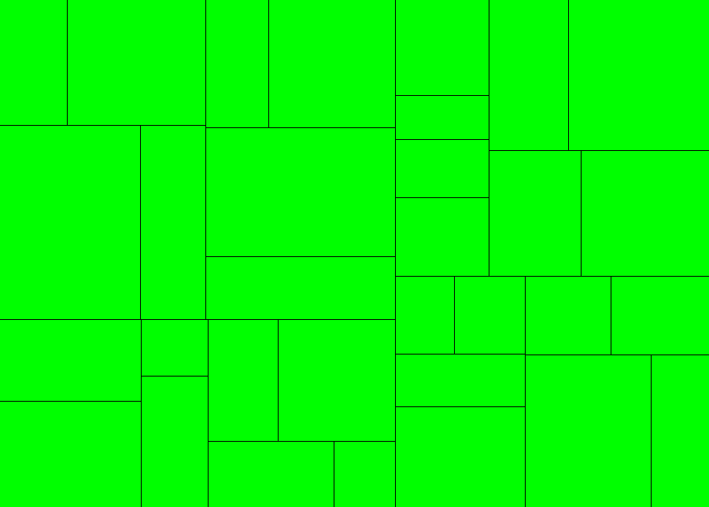
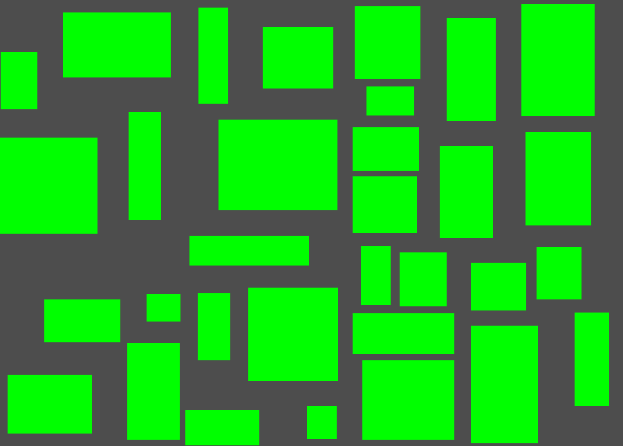
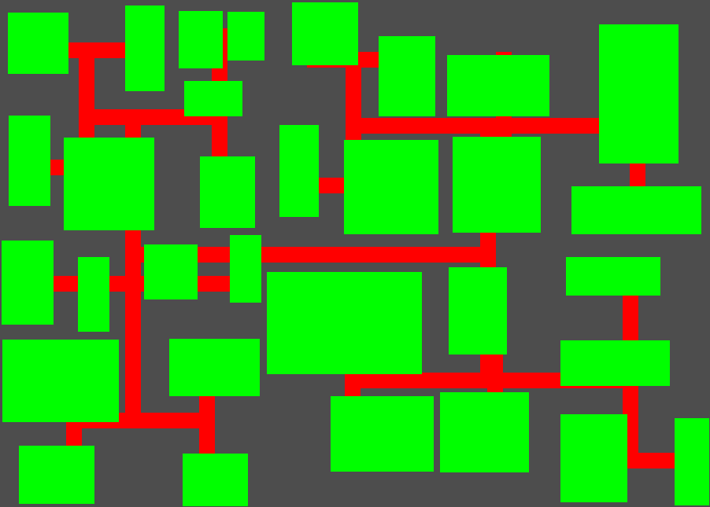
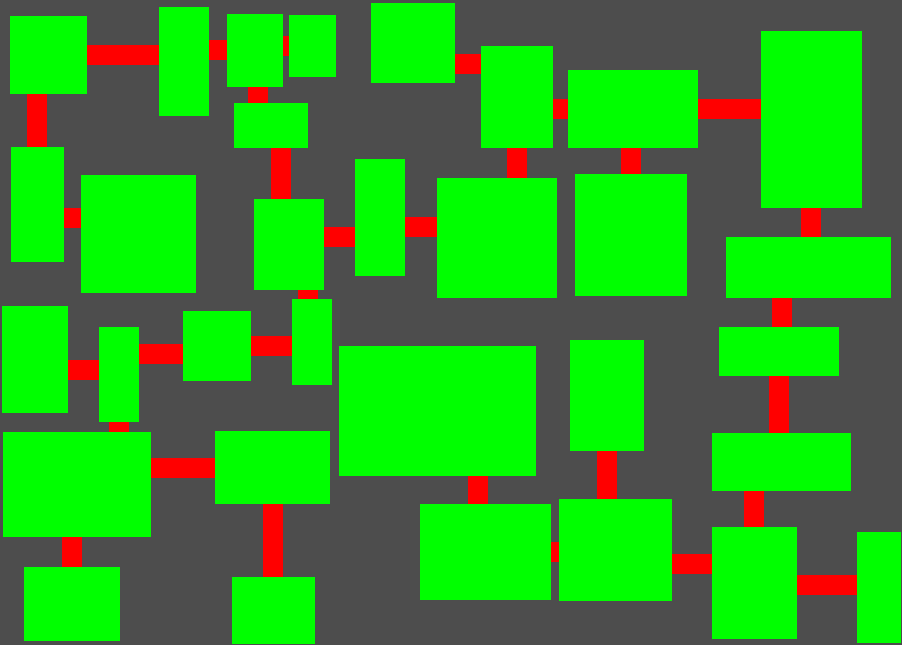
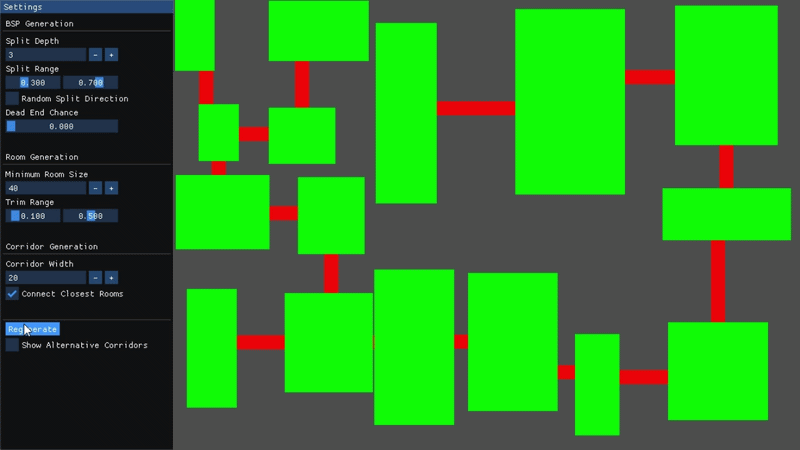

# Binary Space Partitioning for Dungeon Generation

The following is my research project on procedural dungeon generation using binary space partition (BSP) in Godot 4.7, a technique that allows to generate levels in the style of games such as Rogue, Nethack or Cogmind. This project was motivated by my interest in roguelikes and ways to implement procedural generation for them, and also to learn how to use Godot a bit more.

## Introduction

Binary Space Partition is a technique for recursively dividing a region of space into two smaller regions over and over, until some condition is met. It was originally developped for 3D computer graphics and still often used in scenarios where splitting up a physical space is useful, but in this case, it ends up being just as handy for dungeon generation as a way of generating rooms in a way that guaranteeing everything is connected.

As a basic overview of the algorithm is as follows:
1. Start with a rectangle representing your entire level
2. Choose whether to cut the rectangle vertically or horizontally.
3. Choose a random position along the axis of the cut such that the two child rectangles are both above a minimum size.
4. Repeat step 2 on each child triangle until they cannot be cut anymore so another terminating condition (such as recursion depth) is triggered.

Once you've divided a level using this algorithm, you can then create rooms inside each "leaf" rectangle of the resulting tree structure, and can then finally connect all the rooms with corridors.

The pros of using this for procedural dungeons specifically:
- Guaranteed non-overlapping rooms as every split produces two rectangles with no gap and no overlap. There's no need to constantly retry non colliding room placements as you would with a simpler solution of randomly scattering rectagnles until none collide.
- The BSP tree you end up with acts as a free adjaceny graph that already lets you know which rooms are "near" eachother, which also helps with corridor generation
- The approach comes with a lot of tunability as you can mess around with things like the split ratio, minimum room size, and recursion depth among a few, to give you direct control over how cramped vs open the resulting layout ends up being.

## Implementation

### The partition tree
The core data structure is a Branch, a node representing a rectangular region, holding a position, size and (once split) references to two child branches:
```gdscript
class_name Branch
var settings: BspSettings
var position: Vector2i
var size: Vector2i
var depth: int
var left_child: Branch
var right_child: Branch
```
Splitting by default picks the longer axis of the current rectange, which help regions trend toward squarer spaces rather than increasingly thin slivers when it's randomly decided, then it chooses a random split point within a configurable percentage range, and recurses into both halves. I started off with a recursion depth limit as the stopping condition, however that is not a safe condition on it's own since with enough depth it could try to split a region smaller than a viable room. To fix this when attempting a split I also check if the inpending split is at least twice the size of either my minimum room size or my corridor width (as I don't want rooms smaller than connecting corridors either) along the relevant axis. Leaves that hit this guard early simply stop, which also has a nice side effect of a potentially naturally uneven tree, resulting in a mix of smaller subdivided rooms and larger rooms that stopped splitting earlier. I've still added an extra option to force split terminations to force this effect as well.
```gdscript
func split(remaining: int):
	var split_percent = randf_range(settings.split_min_percent, settings.split_max_percent)
	var split_horizontal = size.y >= size.x if not settings.random_split else randf() < 0.5
	
	if randf() < settings.force_dead_end_chance:
		return
	
	if (split_horizontal && size.y >= 2 * max(settings.min_size, settings.corridor_width)):
		var left_height = int(size.y * split_percent)
		left_child = Branch.new(position, Vector2i(size.x, left_height), depth + 1, settings)
		right_child = Branch.new(
			Vector2i(position.x, position.y + left_height),
			Vector2i(size.x, size.y - left_height), depth + 1, settings
		)
	elif (size.x >= 2 * max(settings.min_size, settings.corridor_width)):
		var left_width = int(size.x * split_percent)
		left_child = Branch.new(position, Vector2i(left_width, size.y), depth + 1, settings)
		right_child = Branch.new(
			Vector2i(position.x + left_width, position.y), 
			Vector2i(size.x - left_width, size.y), depth + 1, settings
		)

	if(remaining > 0):
		if (left_child):
			left_child.split(remaining - 1)
		if (right_child):
			right_child.split(remaining - 1)
```



### Placing rooms
After splitting everything the result is a bunch of adjoining rectangles filling the entire space, which is a good start but doesn't particularly make for a good dungeon. To resolve this I made a Trim function that will shrink each leaf inward on all four sides by a random size proportional amount. This ends up with a much nicer looking dungeon already.



### Corridor generation
This turned out to be the most difficult part of the implementation and I tried a couple of different approaches to get something that works.

My first attempt involved walking the tree bottom-up and at every non leaf Branch, connect the center of the left child node with the center of the right child node. This implemntation was simple and guaranteed a fully connected tree, however it also didn't look all that great. It would often result in rooms having redundant corridors between them, corridors running along the entire edge of a room, and if the room was sized differently enough, corridors could overshoot through or even entirely miss some smaller rooms. Needless to say the simplicity wasn't worth it.

My second attempt then involved much the same, however I would instead pick two random rooms from each children of a node and attempt to connect those with a straight corridor, if that wasn't possible I would instead fall-back to creating a bent corridor. This gave me generally better results and this time fully guaranteed that the rooms themselves would also all be connected, however some of the other issues still persisted, but they were resolved with 2 main improvements to this approach.
The first would come up when creating a bent corridor. When bending, a corridor could either first start with a horizontal section and then a vertical one to finish the connection or vice-versa. Originally I picked at random but now instead I create both and pick the one that overlaps with the least rooms.
The second improvement is to then instead of picking a random pair of rooms to connect, pick the closest possible pair of rooms. This change was the most impactful in cleaning up any of the issues I felt with the older implementations.

<table>
  <tr>
    <td align="center">
      
      <br><sub>Initial Corridor Generation</sub>
    </td>
    <td align="center">
      
      <br><sub>Fixed Corridor Generation</sub>
    </td>
  </tr>
</table>

### Tunable Settings
For easier testing I opted early on to implement live tunable settings for dungeon generation, achieved through a resource called BspSettings which gets passed down through the tree:
```gdscript
extends Resource
class_name BspSettings
@export var min_size: int = 40
@export var trim_min_percent: float = 0.1
@export var trim_max_percent: float = 0.5
#...
```
I then put these settings all together in an ImGui window that wraps them in sliders and inputs for live iteration, which helped out a lot.

## Result
The generator produces dungeons with a visibly uneven mix of room sizes, corridors that are always axis-aligned which avoid clipping through unrelated rooms wherever a valid path exists, and a live debug panel for tuning split ratios, trim amounts, corridor width, minimum room size, and various generation toggles.



## Conclusion
Binary Space Partition by itself is a relatively simple algorithm to implement, it's the corridor generation where all the difficulty lies, and where a lot of visual artifacts become easily apparent.

While I'm happy with the result there are still quite a few improvements to generation that could be made. One such improvement could be placing loops, as currently, whilst the entire dungeon is connected, it could result in a lot of backtracking to fully traverse, which is were loops would come in.
Another feature that could be implemented could be to occasionally skip rooms, leaving more empty space for corridors if your game would benefit from that.
You could even implement BSP within rooms themselves to generate loot or obstacle placements.

## References
1. RogueBasin - [Basic BSP Dungeon generation](https://www.roguebasin.com/index.php?title=Basic_BSP_Dungeon_generation)
2. Stone Sigil Games - [Dungeon Generation using Binary Space Partitioning in Godot C# for Traditional Roguelikes](https://stonesigil.com/blog/bsp-roguelike-csharp/)
3. Milo Trulijo - [Dungeon Generation with Binary Space Partitioning](https://backdrifting.net/post/074_bsp_dungeons)
4. Gonzalo Uribe [Dungeon Generation using Binary Space Trees](https://medium.com/@guribemontero/dungeon-generation-using-binary-space-trees-47d4a668e2d0)
5. Jono Shield - [Procedural Dungeon Generation in Godot](https://jonoshields.com/post/bsp-dungeon/)
6. eskerda - [Dungeon generation using BSP trees](https://eskerda.com/bsp-dungeon-generation/)